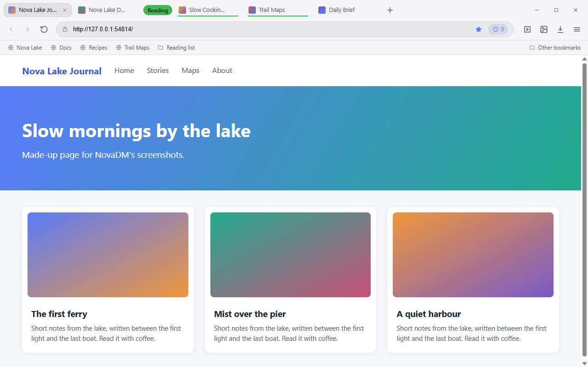
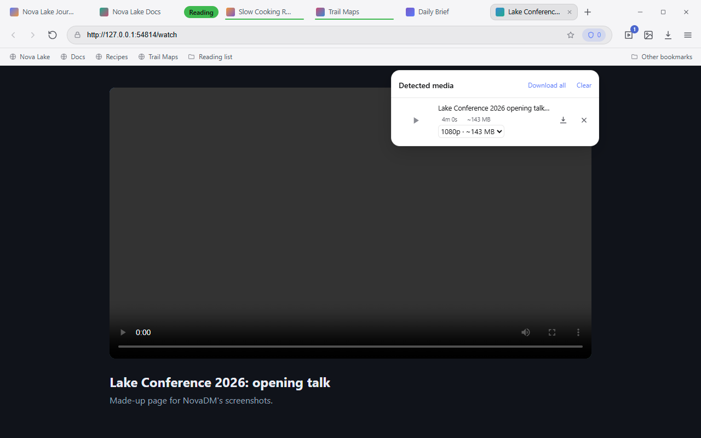
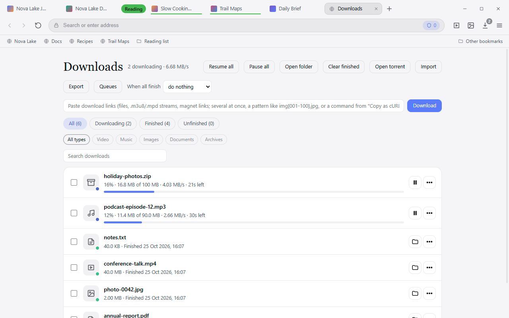
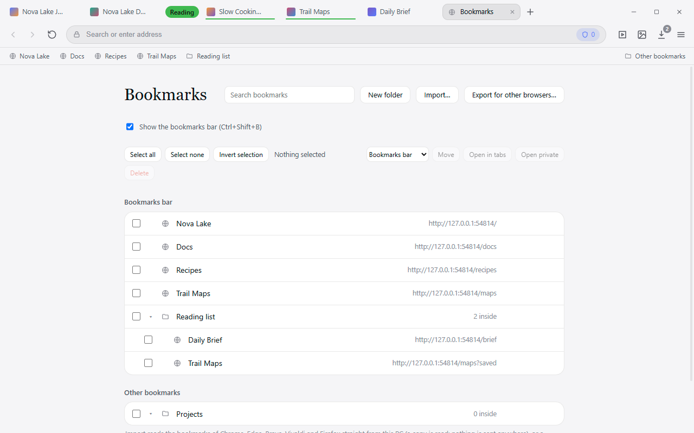
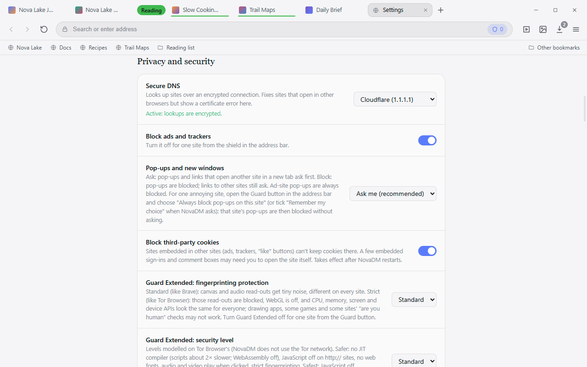
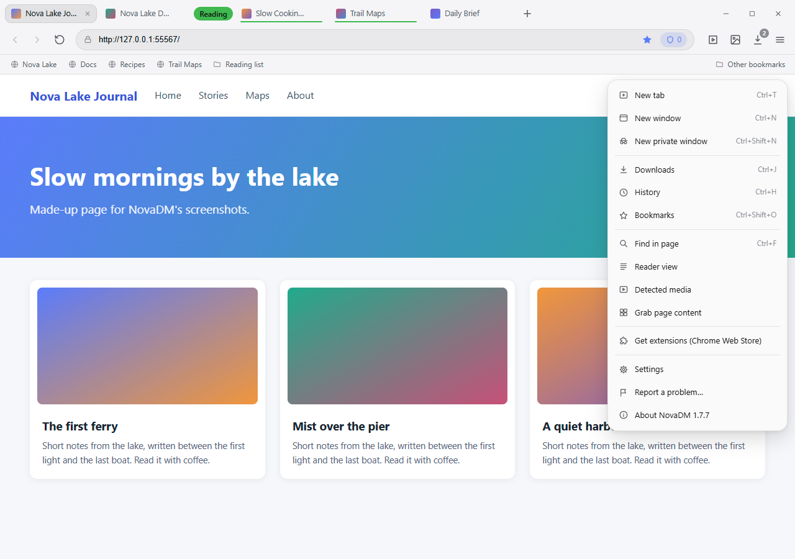

# NovaDM

**A Windows web browser with a fast download manager built in.** Browse with an ad blocker, a
pop-up guard and Guard Extended privacy protections; download files, videos, live streams and torrents
with up to 32 connections, resume after crashes, and schedule everything.

NovaDM is free and open source (GPL-3.0). It is built on Electron (Chromium). Its feature set was
inspired by the Android download manager 1DM, and its download engine borrows ideas from Motrix,
Gopeed, AB Download Manager and XDM. No code from any of them is included.

## Screenshots

<table>
<tr>
<td width="50%"><a href="screenshots/browser.png"></a><br><sub><b>Browser.</b> Tabs and tab groups, a bookmarks bar, the shield for the ad and tracker blocker, and buttons for videos, images, downloads and the menu.</sub></td>
<td width="50%"><a href="screenshots/video.png"></a><br><sub><b>Video.</b> Videos and streams are found as a page plays them, with a choice of quality, and saved as one MP4.</sub></td>
</tr>
<tr>
<td width="50%"><a href="screenshots/downloads.png"></a><br><sub><b>Downloads.</b> Up to 32 connections per file, pause and resume, speed, filters by type, queues and schedules.</sub></td>
<td width="50%"><a href="screenshots/bookmarks.png"></a><br><sub><b>Bookmarks.</b> Folders, drag and drop, and import from and export to other browsers.</sub></td>
</tr>
<tr>
<td width="50%"><a href="screenshots/settings.png"></a><br><sub><b>Privacy and security.</b> Secure DNS, ad and tracker blocking, a pop-up guard, third-party cookies, fingerprinting protection and security levels.</sub></td>
<td width="50%"><a href="screenshots/menu.png"></a><br><sub><b>Menu.</b> Windows and private windows, history, reader view, grabbing a page's images and files, Chrome Web Store extensions.</sub></td>
</tr>
</table>

The pictures show made-up pages and downloads on a clean profile, so no personal data is in them.
`tools/make-screenshots.js` makes them again (how to run it is at the top of that file).

## Download

Get the latest version from [Releases](../../releases):

| File | |
|---|---|
| `NovaDM-Setup-x.y.z.exe` | Installer. Asks whether to add a desktop shortcut and a Start menu entry. |
| `NovaDM-Portable-x.y.z.exe` | No installation: runs from any folder or USB stick. |

Windows 10 or 11, 64-bit. The builds are not code-signed yet, so Windows SmartScreen may show
"Windows protected your PC" the first time: click **More info → Run anyway**. Each release lists
the SHA-256 of its files so you can check your download.

## What it does

**Browser**
- Several windows (Ctrl+N): drag a tab or a whole tab group out into a new window or onto another
  window, and every window comes back when NovaDM starts
- Tabs with **tab groups** (named, coloured, foldable; drag tabs in and out), pinned tabs and a
  right-click tab menu; with many tabs the strip scrolls and a ▾ button lists them all; private windows (their own purple look and taskbar icon), history, bookmarks (a bookmarks bar, nested folders, drag to rearrange, import from and export to Chrome,
  Brave, Edge and Firefox), find in page, reader view, restore tabs on start
- Chrome Web Store extensions
- Brave's keyboard shortcuts (Ctrl+/ lists them), dark/light theme and accent colours
- Tab search (Ctrl+Shift+A); type a site name in the address bar and press Tab to search that
  site (YouTube, Wikipedia, GitHub, …)
- Report a problem (menu): a bug report file with personal data removed, to read and send
- About NovaDM (menu, or Settings → About): the installed version, the build, "Check for updates" with
  what's new in the new version, and the newest yt-dlp, FFmpeg, aria2 and Electron (with a warning when
  an update is a version NovaDM isn't tested with)
- Menu with icons, groups and shortcuts
- Unloads tabs you haven't used for a while, to save memory

**Privacy and safety**
- Ad and tracker blocker (EasyList, EasyPrivacy, uBlock Origin lists, OISD), off per site
- Pop-up guard: asks before a site opens a pop-up; ad pop-ups are blocked; a site can be set to always
  block (or always allow) its pop-ups
- Third-party cookies blocked; tracking redirects skipped; tracking codes removed from addresses;
  http:// upgraded to HTTPS; AMP pages opened on the publisher's site
- **Guard Extended**: fingerprinting protection (Brave-style noise, or strict blocking) and Standard /
  Safer / Safest security levels modelled on Tor Browser's (NovaDM does not use the Tor network), with an
  off switch per site
- Secure DNS (DNS over HTTPS), proxy support, Microsoft Defender scan of downloaded programs,
  Mark of the Web on downloads
- Encrypted cookies, leaked-password and insecure sign-in warnings, tamper-checked app
- A warning on the menu button while an add-on you may need isn't installed
- Warning page for phishing and malware sites; updates itself like Chrome (Update button), the portable version shows a notice

**Downloads**
- Up to 32 connections per file, more than the browser's limit of 6 per server, with the page's
  cookies and Referer kept
- Pause, resume and crash-safe progress; expired links can be refreshed from their page
- Speed limits (all downloads or one), queues with schedules, "when all downloads finish:
  sleep / shut down"
- Checksum check, category rules and folders, unpacking archives, a program or webhook to run
  after each download
- Every download a page starts goes through NovaDM; copied links and lists of links
  (`img[001-100].jpg`) and "Copy as cURL" commands are offered too

**Video**
- Finds videos and audio as pages play them: HLS (`.m3u8`), DASH (`.mpd`), MP4/WebM, subtitles
- Saves streams as one MP4, joining separate picture and sound without FFmpeg
- Records live streams (HLS and DASH)
- Grabs all images of a page
- DRM-protected streams are labelled and not downloaded

**Torrents and other apps**
- Magnet links and `.torrent` files, with file choice and seeding limits (through the aria2 add-on)
- Browser extension for Chrome, Edge and Brave (`browser-extension/`, load it unpacked)
- Command line (`NovaDM.exe --add <link>`), `novadm://` links, and a local API with an MCP endpoint
  for AI assistants (off by default, this PC only)
- Site extensions: small sandboxed scripts that find a site's downloads (example in
  `site-extensions/example`)

### Add-ons (optional, installed separately)

Some features use separate programs that NovaDM downloads only when you click **Install** in
Settings → Add-ons. Each comes from its project's official release and is checked against its
published checksum. You can also point NovaDM at your own copy.

| Add-on | Size | Used for |
|---|---|---|
| [aria2](https://github.com/aria2/aria2) | ~2.5 MB | Torrents and magnet links |
| [FFmpeg](https://github.com/BtbN/FFmpeg-Builds) | ~80 MB | Downloaded videos start at once and seek without delay (made into a normal MP4); joining WebM / plain-MP4 picture and sound, saving sound only, repairing videos |
| [yt-dlp](https://github.com/yt-dlp/yt-dlp) | one .exe | "Find with yt-dlp" for sites NovaDM's own detection can't read; on YouTube it is asked by itself |

## Use responsibly

NovaDM downloads what a site sends to your browser. Download only what you have the right to keep,
and follow each site's terms: some sites, YouTube among them, don't allow downloading in their
terms. NovaDM does not break copy protection: DRM-protected streams are labelled and not
downloaded. yt-dlp, FFmpeg and aria2 are separate programs with their own licenses, downloaded
from their official releases only when you ask for them.

## Privacy

NovaDM has no telemetry, no accounts and no ads of its own. Everything it stores (settings,
downloads list, history, bookmarks, cookies) stays in `%APPDATA%\NovaDM` on your PC.

On its own it only connects to download the ad-block lists (every 4 days) and the phishing lists
(daily), to ask GitHub once a day for a newer NovaDM and download it (installed version; can be turned off), and to the
Secure DNS provider you choose; add-ons and the torrent tracker list are downloaded only when you
use them. When a new NovaDM is found, its release notes come from GitHub too; "Check for updates"
in Settings → About also asks GitHub for the newest yt-dlp, FFmpeg, aria2 and Electron, and asks
OSV.dev and the US National Vulnerability Database about known security problems in those versions
(only the program name and version number are sent). With
yt-dlp installed, opening a YouTube video lets yt-dlp ask YouTube about that video (as the page
does; Settings → Add-ons turns it off). The sites you visit are checked against the lists on your PC, never sent anywhere.
Private windows leave no history or downloads list entries, and their cookies, site data and
sign-ins are deleted when the private window closes. Passwords for proxies and sites are
encrypted with Windows' data protection.

**Sign-ins.** Cookies (what keeps you logged in) are encrypted on disk. When you sign in, NovaDM
warns if the password is in a known data breach (Have I Been Pwned; only the first 5 characters of
the password's hash are sent, never the password) or is sent without HTTPS. The app is locked down
so other programs can't run code through it. To report a security problem, see [SECURITY.md](SECURITY.md).

Windows Firewall may ask about NovaDM the first time a page uses WebRTC (Chromium then opens a
network port); blocking it is fine. NovaDM itself opens no network ports.

## Building from source

Requirements: Windows 10/11 and [Node.js](https://nodejs.org/) 22 or newer.

```bash
npm install
```

```bash
npm start
```

```bash
npm run dist
```

`npm run dist` writes the installer and the portable version to `dist/`.

### Tests

```bash
npm test
```

Unit tests run with `node --test` against local test servers. `tools/selftest-*.js` are in-app
self-tests that run inside Electron with a throwaway profile:

```bat
set NOVADM_USERDATA=%TEMP%\novadm-test-profile
set NOVADM_SELFTEST=tools/selftest-popup.js
node_modules\electron\dist\electron.exe .
```

### Project layout

```
src/main/          Electron main process: tabs, ad blocker, privacy, downloads, add-ons, local API
  download/        download manager and the HTTP, HLS, DASH and torrent engines
  media/           media detection, HLS/DASH parsing, TS→MP4, MP4 merging
src/ui/            toolbar, panels and NovaDM's own pages (downloads, settings, history…)
browser-extension/ the Chrome / Edge / Brave extension
site-extensions/   an example site extension
test/              unit tests
tools/             in-app self-tests, benchmark, icon generator, the screenshot maker
screenshots/       the pictures in this README (made by tools/make-screenshots.js; not part of the app)
build/             installer customisation
```

What changed in each version: [CHANGELOG.md](CHANGELOG.md).

## How changes are made

Every feature and fix goes through the same pipeline: intake and sizing, brainstorm, plan, build,
test, security test, release and maintenance, with automatic checks on GitHub (tests, dependency
audit, CodeQL and free security scanners, build security checks, privacy check).

## License

NovaDM is free software: you can redistribute it and/or modify it under the terms of the
[GNU General Public License](LICENSE), version 3 or (at your option) any later version. It comes
with no warranty.

Libraries keep their own licenses: electron-chrome-extensions (GPL-3.0, the reason NovaDM is
GPL), Ghostery adblocker (MPL-2.0), hls.js, mux.js and Mozilla Readability (Apache-2.0), undici
and electron-chrome-web-store (MIT). Electron and Chromium's licenses ship with the app
(`LICENSES.chromium.html`). The add-ons are separate programs under their own licenses.
