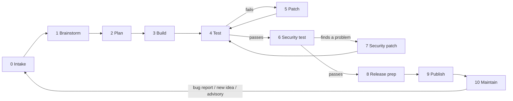
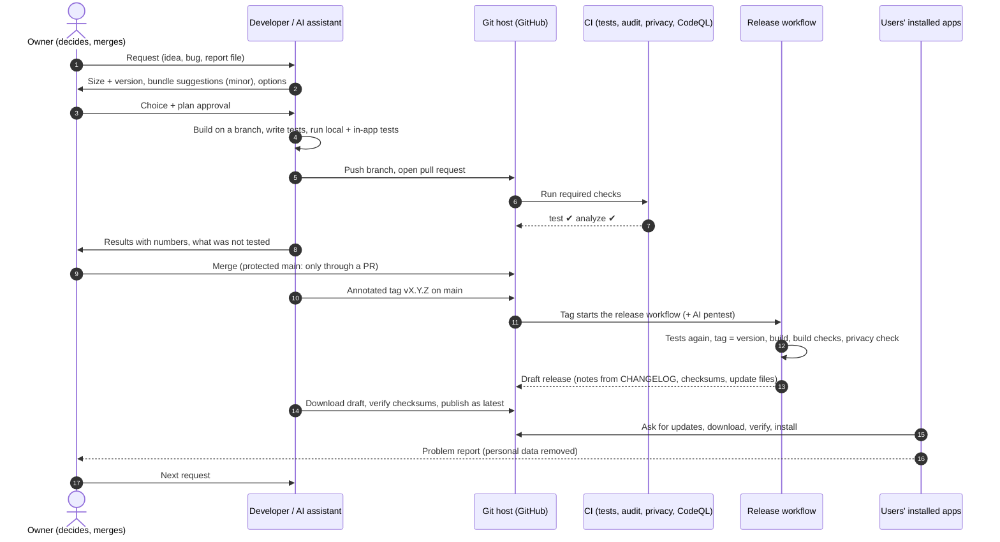

# Software delivery pipeline: a reusable guide

How an idea becomes a released, updatable, maintained version of an app, step by step, with the
CI/CD (DevOps) automation behind it. The guide is written so any project can copy it and fill in
its own tools. Each step ends with **how NovaDM does it**: NovaDM is an Electron browser and
download manager for Windows, built with an AI coding assistant, and is used here as a worked
example.

This document explains the *why* and the *how*. The short rule sheet NovaDM actually follows is
[pipeline.md](pipeline.md).

**Contents**

1. [The sequence at a glance](#1-the-sequence-at-a-glance)
2. [Roles and principles](#2-roles-and-principles)
3. [Stage by stage](#3-stage-by-stage)
4. [CI/CD: the automation](#4-cicd-the-automation)
5. [Release verification and automatic updates](#5-release-verification-and-automatic-updates)
6. [Feedback loop: bug reports and diagnostics](#6-feedback-loop-bug-reports-and-diagnostics)
7. [Docs and project memory](#7-docs-and-project-memory)
8. [Working with an AI coding assistant](#8-working-with-an-ai-coding-assistant)
9. [Copying this to your project](#9-copying-this-to-your-project)
10. [Lessons learned](#10-lessons-learned)
11. [Checklists](#11-checklists)

---

## 1. The sequence at a glance

### The stages

Every request (feature, idea, bug, security advisory) passes through the same stages, in order.
Each stage ends with a **gate**: a condition that must be met before the next stage starts.
Failing a test or a security check loops back instead of moving on.



| # | Stage | Input | Output | Gate | Automated? |
|---|---|---|---|---|---|
| 0 | Intake | a request | size + version number (+ bundle) | size agreed | no |
| 1 | Brainstorm | the request | 2–3 options with costs | one option chosen | no |
| 2 | Plan | the chosen option | plan with acceptance and security questions | owner approves | no |
| 3 | Build | the plan | code + tests on a branch, a pull request | works by hand | partly (CI starts) |
| 4 | Test | the branch | test results with numbers | all pass, as expected | yes (CI) + local |
| 5 | Patch | a failure | a fix + a test that catches it | back to 4 | no |
| 6 | Security test | the branch / build | scan results | no high/critical open | yes (CI) |
| 7 | Security patch | a finding | a fix or a documented accepted risk | back to 4 | no |
| 8 | Release prep | the tested branch | version, changelog, docs, privacy/legal gate | all clean | partly |
| 9 | Publish | merged main | tag, built and verified release | public + installable | yes (release workflow) |
| 10 | Maintain | the release | dependency updates, scans, bug reports | — | yes (scheduled) |

### Who does what, in time order



---

## 2. Roles and principles

### Roles

| Role | Responsible for | Must not |
|---|---|---|
| **Owner** | Deciding size, scope and plan; merging pull requests; holding secrets (API keys, signing certificates); publishing decisions | Skip the gates "just this once" |
| **Builder** (developer or AI assistant) | Sizing, options, plan, code, tests, release prep, verification, honest reports | Merge to main, handle secrets, publish personal data |
| **Automation** (CI) | Repeating every check on every change, the same way every time | Hold more permissions than the job needs |

In a one-person project the owner and builder are the same person; keep the gates anyway. They
are what stop a tired evening from shipping a broken build.

### Principles

1. **Gates, not vibes.** "It seems fine" is not a gate. "These 145 tests pass and this check
   shows the header now says 2:28:16" is.
2. **Everything through a pull request.** The main branch is protected, so CI always runs before code lands.
3. **Test what you ship.** Tests that run from source can pass while the packaged app is broken.
   Check the built artifact too.
4. **Small changes, bundled releases.** Change little at a time, but release when the update is
   worth installing.
5. **Prove the cause before the fix.** Reproduce on the real artifact or data, then fix, then show
   the symptom is gone.
6. **Report honestly.** What passed, what failed, what was not run, and the risks. All with numbers.
7. **Privacy and least privilege by default.** Nothing personal in the repository. No secret in
   code. Each CI job gets only the permissions it needs.
8. **Every version can be rolled back.** Tags, release files and a changelog for every version.

---

## 3. Stage by stage

### Stage 0: Intake (size it)

**Purpose:** decide how big the request is, so you know the version number and how much process
it needs.

**Steps**

1. Restate the request in one sentence and check you understood it.
2. Size it:

   | Size | Typical examples | Version ([SemVer](https://semver.org/)) | Stages needed |
   |---|---|---|---|
   | **Hotfix** | crash, broken behaviour, security advisory | patch `1.4.4` | 0 → 3 → 4 → 6 → 8 → 9 |
   | **Minor** | a setting, a menu item, a small panel | minor `1.5.0`, or patch if bundled into one | all; plan is a short list |
   | **Major** | a new area, a change to stored data | minor or major | all; plan is a document |

3. **Minor requests: bundle them.** One tiny change rarely justifies a release, which every user
   has to download. Suggest 2–4 backlog items from the same area or the same code, and let the
   owner pick.
4. Note the request in the backlog if it is postponed.

**Gate:** size and version agreed; for minor requests, the bundle picked.

> **NovaDM example.** "Show the installed version somewhere" is minor, so it was bundled into
> 1.4.3 with a video-length fix. "Check add-on versions too" was minor; the owner picked *Update
> preview* and *Subtitles with video* from the suggested bundle → 1.4.5. "Add tab grouping" was
> major → 1.5.0, with drag-and-drop, pinned tabs and a tab menu chosen from the same area. The
> backlog lives in `docs/feature-requests-research.md`.

### Stage 1: Brainstorm

**Purpose:** don't build the first idea; compare a few.

**Steps**

1. Who has the problem and when? How do comparable products solve it?
2. List 2–3 ways to build it, each with its cost: size, memory, speed, privacy, maintenance, risk.
3. Check feasibility on your platform (some features need APIs your stack doesn't have).
4. Recommend one, with the reason.

**Gate:** one approach chosen.

> **NovaDM example.** For "warn when an add-on update may break the app", the options were
> (a) warn only, (b) block untested versions, (c) install the tested version by default and allow
> newer only after a warning. The owner chose (c): FFmpeg installs the newest build of the tested
> major version (`TESTED_MAJOR = 9`); a newer major needs **Update anyway** plus a confirmation.

### Stage 2: Plan

**Purpose:** agree on exactly what will be built and how it will be proven, before the code.

**Steps**

1. Files and modules it touches; new settings with their defaults; user-facing text.
2. **Acceptance tests:** what a test will check to prove it works. Write these now.
3. **Security and privacy questions** (answered now, checked in stage 6):
   - Does anything new leave the device? What, to whom? Can it be turned off?
   - Is anything new stored? Where? Encrypted if personal?
   - Can untrusted input (a web page, a file, the network) reach the new code? How is it checked?
   - Does it download or run anything? Is that verified (checksum, signature)?
4. For major requests, write it down as `docs/<version>-plan.md` or similar.
5. Note what you will **not** do (scope cut), so nobody expects it.

**Gate:** the owner approves the plan.

> **NovaDM example.** Tab groups: the plan listed the order rules (pinned tabs first, a group's
> tabs together), the session file change (old sessions must still load), the right-click menus,
> drag and drop, and the acceptance tests ("a group survives a restart with its name, colour and
> folded state"). It also named what was not built: dragging a whole group, and dragging a tab
> out into a new window.

### Stage 3: Build

**Purpose:** make the smallest change that does the whole job, with its tests.

**Steps**

1. Create a branch: `feat/<name>`, `fix/<name>`, `docs/<name>`.
2. Before changing shared code, find every caller ("what depends on X?"). A code search or a code
   knowledge graph helps.
3. Write the change in the style of the surrounding code. No new dependency for a few lines. No
   options nobody asked for.
4. Add the tests from the plan with the code: unit tests for logic, an in-app or integration test
   for behaviour.
5. Push and open a pull request early, so CI runs on every push.
6. **Stacked pull requests:** when version B builds on unmerged version A, branch B from A, and
   say in B's description that A must be merged first.

**Gate:** it works by hand.

> **NovaDM example.** The tab-order rules went into a small module of pure functions
> (`src/main/tab-groups.js`), easy to unit-test. The tab manager only calls them. Versions 1.4.4,
> 1.4.5 and 1.5.0 were open at once as stacked pull requests #11 → #12 → #13, merged in that
> order.

### Stage 4: Test

**Purpose:** prove it works, and that nothing else broke.

**The test layers** (fast to slow):

| Layer | What it proves | Runs | NovaDM |
|---|---|---|---|
| Unit tests | logic and parsers, offline, in seconds | every push (CI) + local | `npm test`: `node --test` with local test servers (150 tests at 1.5.0) |
| In-app self-tests (integration / end-to-end) | the real app, real UI, real windows | local | `tools/selftest-*.js`, run inside Electron with a throwaway profile |
| Regression self-tests | old features still work | local, before each PR | the self-tests for the areas the change touches |
| Performance baseline | no slowdown | local, when UI or page loading changes | `tools/selftest-uiperf.js`: panel open ms, frame times, memory |
| Built-artifact checks | the *packaged* app works and is hardened | local + CI on tags | `tools/check-build-security.js` |

**Steps**

1. Run the unit tests. Add the new ones.
2. Run the feature's own in-app test, then the regression tests for nearby areas.
3. Compare against expectations, not just "no error". Check the output values. For UI changes, take a screenshot and look at it.
4. If a test fails because the **test** is wrong, fix the test and say so.
5. Record the numbers: passed / failed / not run.

**Gate:** everything passes, and the results match what was expected.

> **NovaDM example: the in-app test harness.** A test is a module that receives the app's own
> managers. It drives the real browser, writes a JSON result and quits. It is enabled only when
> the app runs from source, never in the packaged app (the build check verifies this):
>
> ```js
> // main.js
> if (devRun && process.env.NOVADM_SELFTEST) {
>   const t = require(path.resolve(process.env.NOVADM_SELFTEST));
>   setTimeout(() => t({ app, browser, settings, ipc: ipcHandlers, chromeView, /* … */ }), 3000);
> }
> ```
>
> ```bat
> set NOVADM_USERDATA=%TEMP%\novadm-test-profile
> set NOVADM_SELFTEST=tools/selftest-tabgroups.js
> node_modules\electron\dist\electron.exe .
> ```
>
> Multi-phase tests reuse the profile: phase 1 builds tab groups and quits normally, phase 2
> starts again and checks that they came back. External services are replaced by stand-ins (a
> local HTTP server, a fake GitHub API, a fake yt-dlp), so the tests run offline.

### Stage 5: Patch

**Purpose:** fix the cause, not the symptom.

**Steps**

1. Reproduce the failure on the **real** thing (the real file, the real build), not a guess.
2. Find the cause; fix it once, in the shared code.
3. Add a test that fails without the fix and passes with it. Where possible, show both runs.
4. If a fix breaks something else, revert it (`git restore`, `git revert`) and try another way.
5. Back to stage 4.

> **NovaDM example.** A downloaded 2:28:16 video showed 13:15:21. Version 1.4.3 fixed a real
> but different timeline problem, and the symptom stayed. Probing the user's actual file showed
> the video data was right; only the MP4 header said "length unknown" (`0xFFFFFFFF` ticks at
> 90 kHz = 13:15:21). Version 1.4.4 writes the real length into the header. Its test asserts both
> sides: the converter writes "unknown", and the finished file says 30 s. The lesson is in
> section 10.

### Stage 6: Security test

**Purpose:** find vulnerabilities before users do.

| Kind | What it finds | Tool (NovaDM) | Generic alternatives | When |
|---|---|---|---|---|
| **SCA**: dependency audit | known CVEs in libraries | `npm audit --omit=dev --audit-level=high` | `pip-audit`, `govulncheck`, OWASP Dependency-Check, Snyk | every push |
| **SAST**: static analysis | injection, path traversal, unsafe regex, races… in your code | CodeQL `security-extended` | Semgrep, SonarQube | every push + weekly |
| **AI / DAST pentest** | exploitable flaws, proven by trying them | Strix (AI agents, sandboxed) | OWASP ZAP, Burp, manual pentest | each version tag + on demand |
| **Build hardening** | the shipped artifact can't be abused | `tools/check-build-security.js` (14 checks) | code-signing checks, SBOM, container scanners | every build |
| **Privacy gate** | personal data in code, history or build | `tools/check-private.js` | gitleaks, trufflehog (secrets) | every push + build |
| **Electron / framework config** | insecure window options, IPC, navigation | Electronegativity | framework-specific linters (Brakeman for Rails, Bandit for Python, gosec for Go) | every push + weekly |
| **Second SAST** | patterns the first scanner's rules miss | Semgrep Community Edition | SonarQube Community, Bearer | every push + weekly |
| **Second vulnerability database** | advisories `npm audit` doesn't have | OSV-Scanner | Trivy, Grype | every push + weekly |
| **Repository posture** | unpinned actions, broad tokens, unprotected branches | OpenSSF Scorecard | — | main + weekly |
| **Platform features** | leaked secrets, vulnerable dependencies with fix PRs | GitHub secret scanning + push protection, Dependabot alerts + security updates | GitLab / Bitbucket equivalents | continuous |
| **Design review** | the stage-2 security questions | review the diff | — | every change |

**NovaDM build checks**, run against the packaged app:

- Electron fuses: no "run as Node", cookie encryption on, no `NODE_OPTIONS`, no inspector, ASAR
  integrity on, load only from ASAR, and file-protocol privileges as the UI needs them.
- Runtime attempts: run as Node, inject code through `NODE_OPTIONS`, open a debugger port, find
  the test hook enabled. All must fail.
- The app's own pages load. This check was added after a release whose UI was blank (see section 10).
- A tampered `app.asar` does not run.
- Cookies are stored encrypted.

**Free first, paid last.** Static scanners, dependency databases and the platform's own features
cost nothing and run on every change. An AI pentest is a bonus on release tags: on a free model
quota a full scan stops with HTTP 429 (too many requests), so never make it the only deep check.

**Gate:** no high or critical finding left open.

### Stage 7: Security patch

**Steps**

1. Fix it: update or override the dependency, validate the input, check the message sender.
2. Add a test that would have caught it.
3. A **false positive** is dismissed in the scanner with a written reason, never silently.
4. If no fix exists, document the accepted risk and its workaround (changelog + security doc).
5. Back to stage 4.

> **NovaDM example.** CodeQL alerts were split into three groups:
> - Fixed: temp-file races, regexes, header maps, timer caps.
> - Dismissed as false positives, each with a reason.
> - Dismissed as "won't fix" with the reasoning written down, for code that only runs in local
>   test tools.

### Stage 8: Release prep

**Steps**

1. Bump the version in every place it lives (for npm: `npm version X.Y.Z --no-git-tag-version`
   updates `package.json` and the lockfile).
2. **Changelog:** move "Unreleased" under the new version, with Added / Changed / Fixed / Security
   sections. Write for users ("Downloaded videos showed the wrong length"), not for developers.
   This text becomes the release notes and the in-app update preview.
3. Update the README features, the security doc, and the backlog table.
4. **Privacy gate:** no personal data in files, commit authors or the build. Keep your own
   patterns (name, e-mail, private site names) in a git-ignored file, so the list itself is
   never published.
5. **Legal gate** (see the checklist in section 11): your license is shipped with the binary;
   dependency licenses are compatible; the privacy statement matches what the app really sends;
   nothing in the repository comes from taking apart someone else's closed software.

**Gate:** all checks clean.

> **NovaDM example.** The privacy check runs in CI on every push. It looks for Windows user
> folders and e-mail addresses, with an allow-list for things like GitHub's Dependabot address,
> plus the owner's own patterns from `.private-patterns`, which git ignores. Version 1.4.5 added
> the GPL license file next to the installed `.exe` after a legal review found it missing.

### Stage 9: Publish

**Steps**

1. CI is green on the pull request → the **owner** merges into main.
2. Tag the merge commit with an annotated tag whose message is the changelog section:
   `git tag -a v1.4.3 -F notes.md && git push origin v1.4.3`.
3. The tag starts the release workflow: tests again, tag equals version, build, build checks,
   privacy check, then a **draft** release with notes, checksums and update files.
4. Verify the draft (section 5): files present, checksums match, notes right.
5. Publish it and mark it as the latest release.

**Gate:** the release is public and installs on a clean machine.

### Stage 10: Maintain

- **Dependency updates:** Dependabot opens pull requests (npm weekly, grouped minor and patch;
  GitHub Actions monthly). Each one goes through CI like any change. Major framework updates get a
  full stage 4.
- **Scheduled scans:** CodeQL weekly, so new rules check old code.
- **Bug reports** go back to stage 0 (section 6).
- **Rollback:** every version has a tag, a release and its installer.
- **Refresh project knowledge** after each release (section 7).

---

## 4. CI/CD: the automation

### Workflow map

| Workflow | Trigger | What it does | Blocks merging? | NovaDM file |
|---|---|---|---|---|
| **CI** | push to main, every pull request, called by Release | install, unit tests, dependency audit, privacy check | yes (`test`) | `.github/workflows/ci.yml` |
| **CodeQL** | push to main, pull requests, weekly | static security analysis | yes (`analyze`) | `.github/workflows/codeql.yml` + `.github/codeql/codeql-config.yml` |
| **Release** | version tag `v*` only | CI again → tag = version → build → build checks → privacy → draft release | — | `.github/workflows/release.yml` |
| **Security scans** | push to main, pull requests, weekly, manual | Electronegativity, Semgrep, OSV-Scanner, Scorecard → Security tab | no (triaged like CodeQL) | `.github/workflows/security-scans.yml` |
| **AI pentest** | version tag + manual run | Strix agents attack the source in a sandbox, capped budget | no (shows red on the tag) | `.github/workflows/strix.yml` |
| **Dependabot** | schedule | dependency update pull requests | goes through CI | `.github/dependabot.yml` |

### CI (every change)

```yaml
name: CI
on:
  push: { branches: [main] }
  pull_request:
  workflow_call:            # the release workflow reuses it
permissions:
  contents: read            # least privilege
jobs:
  test:
    runs-on: windows-latest # the platform you ship for
    steps:
      - uses: actions/checkout@v7
        with: { fetch-depth: 0 }      # the privacy check reads the whole history
      - uses: actions/setup-node@v7
        with: { node-version: 24, cache: npm }
      - run: npm ci                    # exact versions from the lockfile
      - name: Install Electron         # unpack once, before parallel tests race to do it
        run: node node_modules/electron/install.js
      - run: npm test
      - run: npm audit --omit=dev --audit-level=high
      - run: node tools/check-private.js
```

**Copy it:** swap the install, test, audit and privacy commands for your stack. Keep
`workflow_call`, so the release reuses exactly the same checks.

### Release (version tags only)

The key ideas:

- Trigger **only on tags**, so pull requests don't show an empty "release" check.
- **Re-run CI first** (`uses: ./.github/workflows/ci.yml`) and make the build job depend on it.
- **Fail when the tag and the version file disagree.** This catches a forgotten version bump:

  ```bash
  v="$(node -p "require('./package.json').version")"
  [ "v$v" = "$GITHUB_REF_NAME" ] || { echo "::error::Tag $GITHUB_REF_NAME but package.json says $v"; exit 1; }
  ```

- Build, then run the **build checks** and the **privacy check on the build**.
- Release notes come from the changelog (one source of truth), plus a checksum table:

  ```bash
  awk -v h="## [$v]" 'index($0, h) == 1 { on = 1; next } on && /^## \[/ { exit } on' CHANGELOG.md > notes.md
  for f in "App-Setup-$v.exe" "App-Portable-$v.exe"; do
    echo "| $f | \`$(sha256sum "dist/$f" | cut -d' ' -f1)\` |" >> notes.md
  done
  ```

- Create a **draft** release (`gh release create … --draft --verify-tag`). A human verifies and
  publishes it.
- Only this job gets `contents: write`; everything else stays read-only.
- Attach the **update metadata** (for Electron: `latest.yml` and the installer `.blockmap`).
  Without them, installed copies cannot update themselves.

### CodeQL

```yaml
on: { push: { branches: [main] }, pull_request:, schedule: [{ cron: '17 3 * * 1' }] }
permissions: { contents: read, security-events: write }
# init: languages: javascript-typescript, queries: security-extended, config-file: …
# config: paths-ignore the code that never ships (local test tools), with the reason written down
```

### AI penetration test (optional, costs money)

- Runs on version tags and on demand (`workflow_dispatch` with inputs for depth and budget).
- **Skips with a warning when the API key secret is missing**, instead of failing every build.
- The tool version is pinned (`pip install strix-agent==1.6.2`). The model comes from a repository
  variable (`vars.STRIX_LLM`), so it can change without touching code.
- A spending cap per run (`--max-budget-usd`). A scope file says what to attack and what is out
  of scope (`.github/strix-instructions.md`).
- The report is kept as a build artifact for 30 days.

### Dependabot

```yaml
version: 2
updates:
  - package-ecosystem: npm
    directory: /
    schedule: { interval: weekly }
    groups: { minor-and-patch: { update-types: [minor, patch] } }  # one PR instead of twenty
  - package-ecosystem: github-actions
    directory: /
    schedule: { interval: monthly }
```

### Free security scanners (no keys, no cost)

One workflow, `security-scans.yml`, runs four scanners on every pull request, on main, weekly and on
demand, and sends each result to the Security tab as SARIF (a standard results format) next to
CodeQL's:

```yaml
permissions: { contents: read }
jobs:
  electronegativity:            # Electron misconfigurations
    permissions: { contents: read, security-events: write }
    steps:
      - uses: actions/checkout@v7
      - uses: actions/setup-node@v7
        with: { node-version: 24 }
      - run: npx --yes @doyensec/electronegativity@1.10.3 --input src --relative --electron-version 44.7.0 --output electronegativity.sarif
      - uses: github/codeql-action/upload-sarif@v4
        with: { sarif_file: electronegativity.sarif, category: electronegativity }
  semgrep:                      # a second static scanner with different rules
    steps:
      - run: pip install semgrep==1.177.0
      - run: semgrep scan --config p/javascript --config p/nodejsscan --metrics=off --sarif --output semgrep.sarif src browser-extension
  osv-scanner:                  # a second vulnerability database for the lockfile
    uses: google/osv-scanner-action/.github/workflows/osv-scanner-reusable.yml@v2.6.0
    with: { scan-args: "--lockfile=package-lock.json", fail-on-vuln: false }
  scorecard:                    # how the repository is protected (default branch only)
    if: github.event_name != 'pull_request'
    steps:
      - uses: ossf/scorecard-action@v2.4.4
        with: { results_file: scorecard.sarif, results_format: sarif, publish_results: false }
```

They are **not** required checks: a new scanner reports what is already there on its first run, so
findings are triaged first (fixed, or dismissed in GitHub with a reason). Make one required once it
is clean, if you want it to block merging.

### Repository security settings (free on public repositories)

Settings → *Advanced Security* (the names change now and then; the features don't):

| Setting | Turn on | Why |
|---|---|---|
| Private vulnerability reporting | yes | researchers report privately; pair it with a `SECURITY.md` |
| Dependency graph | yes (always on for public repositories) | needed by Dependabot |
| Dependabot alerts | yes | known vulnerabilities in your dependencies and CI actions |
| Dependabot security updates (+ grouped) | yes | fix pull requests opened for you |
| Code scanning: CodeQL | keep **Advanced** if you have a CodeQL workflow ("Default setup" would replace it) | static analysis on every change |
| Copilot Autofix for code scanning | yes, if offered | a suggested fix on each finding |
| Secret scanning, push protection, validity checks, non-provider patterns | yes | leaked keys found, and blocked before they are pushed |

### Security policy (`SECURITY.md`)

A `SECURITY.md` at the repository root tells people how to report a problem without opening a
public issue: which versions get fixes, the private reporting link, what to include, what happens
next, and what is in and out of scope. GitHub links it from the Security tab.

### Branch protection (repository settings)

| Setting | Value | Why |
|---|---|---|
| Require a pull request before merging | on | every change gets CI |
| Required status checks | `test`, `analyze` | tests, audit, privacy and CodeQL must pass |
| Allow force pushes | off | history can't be rewritten by accident |
| Allow deletion | off | main can't be deleted |
| Who merges | the owner | the builder (or AI assistant) proposes, the owner decides |

### Secrets and supply chain

- **Secrets** live in the CI secret store (`secrets.LLM_API_KEY`), never in code, chat or logs.
  The owner adds them; the builder never sees them.
- **Settings that aren't secret** go in repository variables (`vars.STRIX_LLM`).
- **Pin what you run:** the lockfile with `npm ci`, pinned tool versions, pinned action major
  versions (kept current by Dependabot).
- **Verify what you download at runtime.** NovaDM's add-ons:
  - yt-dlp is checked against its published SHA-256 list.
  - FFmpeg is checked against the builder's checksum file.
  - aria2 publishes no checksums, so its SHA-256 is pinned in the code, and NovaDM installs only
    that version.
  - App updates are checked against the SHA-512 in `latest.yml`.

---

## 5. Release verification and automatic updates

### Verify the draft before publishing

```bash
gh release download vX.Y.Z -R owner/repo --dir ./verify
```

```js
// verify.js: the installer's SHA-512 must equal the one in latest.yml (what the updater checks);
// each file's SHA-256 must equal the release notes.
const fs = require('fs'), c = require('crypto');
const want = fs.readFileSync('latest.yml', 'utf8').match(/^sha512: (.+)$/m)[1].trim();
const exe = fs.readFileSync('App-Setup-X.Y.Z.exe');
console.log('sha512 = latest.yml:', c.createHash('sha512').update(exe).digest('base64') === want);
for (const f of ['App-Setup-X.Y.Z.exe', 'App-Portable-X.Y.Z.exe'])
  console.log(f, c.createHash('sha256').update(fs.readFileSync(f)).digest('hex'));
```

Then publish: `gh release edit vX.Y.Z --draft=false --latest`.

### The update channel

| Piece | Purpose | NovaDM |
|---|---|---|
| Update metadata file | newest version, file name, SHA-512, size | `latest.yml` (electron-updater, GitHub provider) |
| Differential file | download only the changed blocks | `NovaDM-Setup-X.Y.Z.exe.blockmap` |
| Client | checks daily, downloads in the background, verifies, installs on restart | `src/main/updater.js` |
| Portable / source runs | can't update themselves: a notice links to the release | `src/main/updates.js` |
| Update preview | what's new in every version since the installed one | release notes from GitHub, shown as text only |
| Test | a stand-in update server; a tampered file must be rejected | `tools/selftest-updater.js` |

**Rule:** a release without its update metadata strands every installed copy. Make the release
workflow attach it, and make verification check it.

---

## 6. Feedback loop: bug reports and diagnostics

A built-in **"Report a problem"** saves a text file the user can read before sending. It is the
cheapest observability a desktop app can have, and it doesn't need telemetry.

**What to include:**
- versions (app, runtime, OS) and the install type
- settings: names only, or values with private ones masked
- add-on versions and the update status
- counts of windows and tabs
- the last N operations (downloads), technical fields only
- the last errors, warnings and crashes
- notes from inside the code at decision points ("stream ts, 890 segments", "picture header removed")

**What to remove:**
- full web addresses (keep only the site)
- user names, PC names and folder paths
- e-mail addresses, passwords, cookies

**How to use it:**
1. Read every line of a report. The warnings are often unrelated bugs worth fixing.
2. If a report lacked what you needed, **add that to the report** in the same release.
3. Fix, and add a test that would have failed with the report's data.

> **NovaDM example.** One report from 1.4.3 led to four fixes in 1.4.4:
> - The video length: the report showed the download path (`ts`, 890 segments), so the file could
>   be probed locally.
> - "884/890 segments" on a finished download.
> - An `extensions init failed` error at start with restored tabs.
> - A noisy event-listener warning.
>
> Version 1.4.4 also logs "length written to the file", so the next report shows it directly.

---

## 7. Docs and project memory

| Document | Holds | Updated |
|---|---|---|
| `README.md` | features, install, privacy, "use responsibly", build and test | each release |
| `CHANGELOG.md` | every version, user-facing language | each release (source of the release notes) |
| `docs/pipeline.md` | the short rules of this pipeline | when the process changes |
| `docs/security.md` | each protection, how it is tested, its limits | when a protection changes |
| `docs/<version>-plan.md` | plans for major work | stage 2 |
| backlog table | ideas, with status: done / on hold / not done | stage 0 and 8 |
| assistant rules file (`CLAUDE.md`) | how an AI assistant must work in this repo | when rules change |
| **code knowledge graph** (optional) | "what depends on X?" answers | after each release |

> **NovaDM example: the knowledge graph.** The code graph (graphify) is refreshed after every
> release from the code only. That step is structural, free and incremental. The slower AI pass
> over the docs runs only when the docs changed a lot. The graph is queried at the start of a
> session and before big refactors. Before tab groups: "what depends on the tab order,
> `serializeTab` and the tabs event?"

---

## 8. Working with an AI coding assistant

The pipeline works the same with an AI assistant as the builder. These rules keep the owner in
control:

1. **A rules file in the repository** tells the assistant to follow the pipeline stage by stage:
   size first, suggest bundles for minor requests, stop at the gates, report test numbers including
   failures, run the privacy check before every push. NovaDM's is `CLAUDE.md`.
2. **The assistant cannot merge.** With branch protection, and the owner merging by hand, nothing
   reaches main without a human decision.
3. **The assistant never handles secrets.** The owner adds API keys to the CI secret store.
4. **Privacy rules are written down,** with the patterns kept in a git-ignored file: never commit
   personal names, e-mails, local paths, browsing history or private site names.
5. **Ask before risky or outside actions:** downloading third-party programs, rewriting history,
   publishing, changing user files. Approval for one action doesn't carry over to the next.
6. **Memory between sessions:** a short project memory (where things are, decisions, what's on
   hold) so a new session doesn't relearn or re-litigate.

---

## 9. Copying this to your project

### Minimum viable pipeline (one afternoon)

1. Protect main: require a pull request and one required check.
2. One CI workflow: install, unit tests, dependency audit.
3. A `CHANGELOG.md` and version tags.
4. A release workflow on tags that builds and drafts the release.
5. Dependabot.

### Then add, in this order

1. A static security scan (CodeQL or Semgrep) as a second required check.
2. The free platform features: secret scanning + push protection, Dependabot alerts and security
   updates, private vulnerability reporting, and a `SECURITY.md`.
3. More free scanners in one non-blocking workflow (a framework-specific one, a second SAST, a
   second vulnerability database, Scorecard).
4. A privacy gate for personal data.
5. Checks on the **built artifact**.
6. Integration or in-app tests with stand-ins for external services.
7. Release verification (checksums) and an update channel with metadata.
8. A bug-report file with personal data removed.
9. An AI or DAST penetration test on release tags, with a budget cap (optional; mind free quotas).

### Tool equivalents

| Need | NovaDM (Electron/Node) | Python | Go | Web app | Mobile |
|---|---|---|---|---|---|
| Unit tests | `node --test` | pytest | `go test` | Vitest / Jest | XCTest / JUnit |
| Integration / E2E | in-app self-tests | pytest + fixtures | testcontainers | Playwright | Espresso / XCUITest |
| Dependency audit | `npm audit` | pip-audit | govulncheck | `npm audit` | Gradle / OWASP DC |
| Static analysis | CodeQL | CodeQL / Bandit | CodeQL / gosec | CodeQL / Semgrep | MobSF / CodeQL |
| Secrets / privacy | `check-private.js` | gitleaks | gitleaks | gitleaks | gitleaks |
| Build hardening | Electron fuses check | wheel signing, SBOM | `-trimpath`, SBOM | CSP / headers check | ProGuard, signing |
| Release | GitHub Releases + `gh` | PyPI trusted publishing | GoReleaser | deploy pipeline | store upload |
| Updates | electron-updater | pip | GoReleaser + self-update | instant on deploy | app stores |

---

## 10. Lessons learned

| Version | What went wrong | Root cause | What the pipeline gained |
|---|---|---|---|
| 1.3.0–1.4.0 | Installed app showed a blank toolbar; every check passed | a hardening setting (fuse) blocked the app's own UI files, and all tests ran from source | a build check: "the app's own pages load". **Test the built artifact.** |
| 1.4.3 | A fix shipped, but the symptom stayed | the cause was guessed from the symptom, not measured on the real file | probe the real artifact first; tests assert the user-visible symptom (header length) |
| CI | Random test failures ("file exists") | parallel tests raced to unpack Electron | an explicit install step before tests |
| CI | Privacy check failed on a dependency update | Dependabot's sign-off e-mail looked like personal data | an allow-list with a comment explaining each entry |
| Releases | An empty "release" check on every pull request | the release workflow ran on every push | trigger the release on tags only |
| Process | The assistant tried to merge its own PR | merging is the owner's decision | branch protection + "the owner merges" rule |
| Knowledge graph | Duplicate nodes after an update | absolute paths in the incremental pass | relative paths; use the tool's own update command |
| Legal | The installed app shipped without its own license; the docs described another app's internals | not part of the checklist | the legal gate in release prep (section 11) |
| Security | The AI pentest failed on three releases in a row | the free model quota ran out mid-scan (HTTP 429) | free scanners in CI as the main deep check; the AI pentest only as a bonus |
| Security | Dependabot alerts, secret scanning and private reporting were all off | public-repository features are opt-in | a settings table (section 4) and a `SECURITY.md` |
| Git | Small edits became whole-file diffs, stacked branches conflicted | Windows tools wrote CRLF line endings into LF files | `.gitattributes` (`* text=auto eol=lf`) and a one-time renormalization |
| Git | A later version's PR was merged before the earlier one | stacked PRs, merged out of order | each version is still tagged on its own last commit (stage 9) |
| Video | Downloaded videos took ~20 s to start and seeked slowly in Windows players | fragmented MP4 (the streaming format) saved as the final file | post-processing rewrites it as a normal MP4 with the index first (FFmpeg, no re-encoding) |

---

## 11. Checklists

### Pull request

- [ ] Branch named `feat/…` / `fix/…`; the description says what, why, and what was **not** done.
- [ ] Unit tests added/updated; all pass (give the number).
- [ ] The feature's integration test and the nearby regression tests pass.
- [ ] UI changed → screenshot checked; performance baseline compared.
- [ ] Stage-2 security questions answered in the diff.
- [ ] Privacy check clean.
- [ ] Stacked on another PR? Say which, and the merge order.

### Release

- [ ] Version bumped everywhere; tag = version.
- [ ] CHANGELOG section written for users; README / security doc / backlog updated.
- [ ] Privacy check on the repository **and** the build.
- [ ] Build checks pass on the packaged app.
- [ ] Legal gate:
  - your license ships with the binary;
  - dependency licenses are compatible (copyleft, MPL, Apache NOTICE);
  - downloaded tools come from official sources;
  - the privacy statement lists every connection the app makes on its own;
  - a "use responsibly" note if users can download third-party content;
  - no material from taking apart someone else's closed software;
  - trademarks only used to describe, not as your own names.
- [ ] Security tab: no new high/critical finding from CodeQL, the free scanners or Dependabot.
- [ ] Draft verified: files and update metadata present, checksums match, notes right.
- [ ] Published as latest; tag annotated with the notes.
- [ ] After release: knowledge graph / docs refreshed, backlog updated.

### Releasing two versions merged together

1. Find the last commit of the earlier version (its version file says that version; it is in
   main's history): `git log --oneline main`.
2. Check its CI passed, then tag it: `git tag -a v1.4.5 <commit> -F notes.md` (notes from that
   commit's changelog), and tag main for the later version.
3. Both release workflows build; verify both drafts; publish the earlier one first, then the later
   one as *latest*, so updaters end on the newest.

### Hotfix fast path

Intake → Build → Test (unit + the failing scenario + nearby regressions) → Security (CI) →
Release prep → Publish. Skip brainstorm and plan documents, never the tests or the gates.
